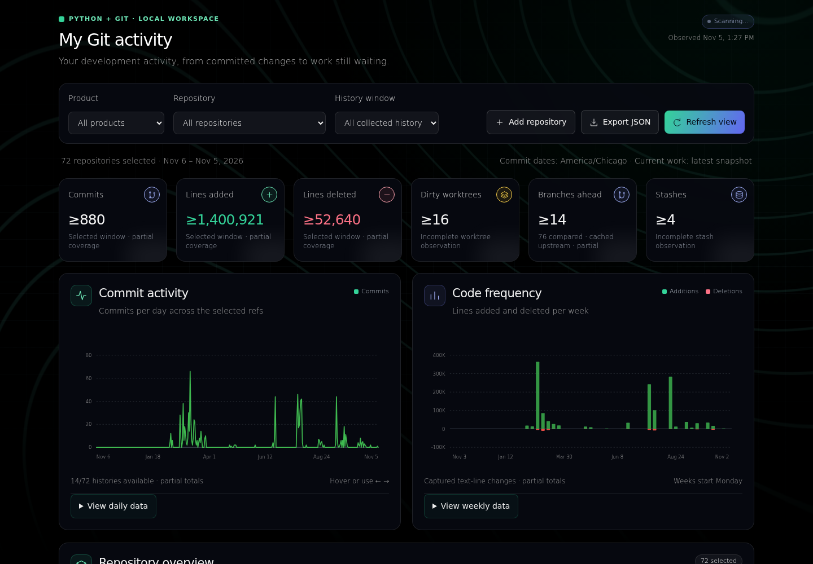
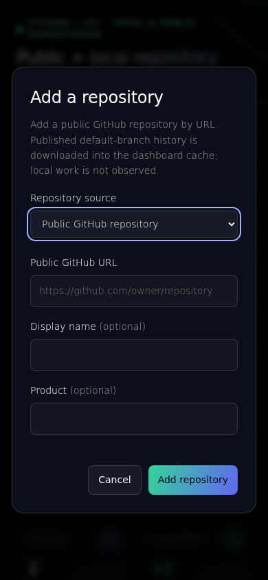

<div align="center">

# CommitandSee

### See the work GitHub can't see.

**A local-first Git dashboard that reveals unfinished work across repositories, branches, worktrees, and stashes.**

Python 3.11+ · Git 2.37+ · No third-party Python packages · Local-first · Read-only observation

[Try it in 3 commands](#quick-start) · [See the dashboard](#the-dashboard) · [What it catches](#what-commitandsee-finds) · [GitHub comparison](#why-not-just-github) · [Full documentation](#add-a-repository-from-the-dashboard)

</div>



*Real local dashboard capture. Pending sources and partial totals stay visible; remote comparisons use cached information.*

## The problem

You made progress today. But where is it?

Maybe the code is **uncommitted in another worktree**, **committed but not pushed**, **sitting on an unmerged branch**, or **hidden in a stash**. GitHub shows what was published; it cannot directly inspect your local checkout. A product spanning multiple repositories makes that blind spot worse.

**CommitandSee puts local working state and committed history in one view**, so you can see what's moving and what deserves review. It does not change your repositories.

## The dashboard

- **Momentum:** daily commits, weekly additions/deletions, filters by product and repository, selectable history windows.
- **Loose ends:** staged, unstaged, untracked, and conflicted paths; linked worktrees; local branches ahead of cached upstreams; stashes; ancestry-based unmerged candidates.
- **Evidence, not guesswork:** observation timestamps, missing data, shallow/truncated history, and source errors remain visible.
- **Multiple repositories:** group separate Git repositories into one product-level view.



*Screenshot of the repository-add flow on a narrow viewport.*

## Portable Windows app

The Windows portable bundle includes Python. Install Git for Windows, extract
**the whole ZIP**, and open `CommitandSee.exe`; the dashboard opens in your default
browser. Use **Add repository** to choose a local checkout or a public GitHub URL.
See [release notes](RELEASE-NOTES.md) for candidate status and
[GitHub Releases](https://github.com/TOTALLYMAJOR/CommitandSee/releases) for
published download assets.

Keep the launcher console open while using the dashboard; press **Ctrl+C** there
to stop it. Closing the browser tab does not stop collection. Settings, registry,
observations, and public caches are stored under `%LOCALAPPDATA%\CommitandSee`,
separate from the extracted app. To update, stop the app and replace its complete
extracted folder; your saved data remains. Stop all instances before backing up
or moving the configuration and its registry together.

This is a Windows-specific, unsigned portable build, with no installed background
service or automatic updater. The Git prerequisite and platform-specific build
are intentional. [Packaging instructions](packaging/README.md) explain how to
build it; the Python source quick start below remains available.

## Quick start

Install **Python 3.11+** and **Git 2.37+**. Then run:

```bash
git clone https://github.com/TOTALLYMAJOR/CommitandSee.git
cd CommitandSee
python3 git_dashboard.py serve --repo /absolute/path/to/your/project
```

Open **http://127.0.0.1:8765** in your browser. Local observations refresh every 30 seconds by default while the server is running. Stop with **Ctrl+C**.

**Want to see the interface without configuring Git?** Open [demo.html](demo.html) from the repository. It is a static, synthetic sample—not live repository data.

**Need multiple projects?** Repeat `--repo` for each local checkout, or use [config.example.json](config.example.json) to group repositories by product. The dashboard can also add public GitHub repository URLs when launched with an external configuration file; public-source history is downloaded into a separate bare cache, not into your worktrees.

## What CommitandSee finds

| Question | Evidence surfaced |
| --- | --- |
| What did I work on? | Commit history, changed-line trends, and repository/product breakdowns |
| What work isn't committed? | Staged, unstaged, untracked, and conflicted working-tree paths |
| What did I leave elsewhere? | Linked worktree state, stashes, and reviewable branches |
| What might not be published? | Branches ahead of **locally cached** upstream refs |
| What might not be merged? | Git ancestry relative to the selected ref (not GitHub PR status) |
| How trustworthy is the view? | Partial collection, stale comparisons, missing refs, and observation warnings |

## Why not just GitHub?

| GitHub | CommitandSee |
| --- | --- |
| Strong source of truth for pushed commits, pull requests, reviews, checks, and releases | Local-first visibility into *uncommitted* files, unpublished branches, worktrees, and stashes |
| Repository-centered collaboration and hosting | One dashboard for several local repositories that collectively make up a product |
| Cannot directly see the state of your local working directories | Observes local Git state without staging, committing, pushing, or merging |
| Current hosted PR/CI information | Git history and cached upstream comparisons; **does not claim live PR/CI status** |

**Complement GitHub, don't replace it.** For collaboration, checks, and authoritative remote state, use GitHub. For the work that hasn't reached GitHub, use CommitandSee.

## What it deliberately does not do

It does **not** push code, merge branches, stage files, run arbitrary project code, report live PR/CI status, or equate line counts with productivity. Cached upstreams may be stale; absent upstreams are unknown, not proof that code was never pushed. Public repository sources cannot expose someone else's local working state. See [verification and limitations](VERIFICATION.md).

## Who it's for

Solo developers, maintainers, AI-assisted builders, and small teams coordinating products that span multiple Git repositories. If you've ever asked “what did I change, and where did I leave it?”, this is for you.

**If CommitandSee solves a problem you recognize, [star the repository](https://github.com/TOTALLYMAJOR/CommitandSee) to help other developers discover it.** For bugs or concrete improvements, [open an issue](https://github.com/TOTALLYMAJOR/CommitandSee/issues). Stars are appreciated, not required to use the tool.

---

## Detailed usage

## Add a repository from the dashboard

Run with a configuration file stored **outside monitored repositories**:

```bash
mkdir -p ~/.config/work-visibility
cp config.example.json ~/.config/work-visibility/config.json
# Set the initial repository paths in that file, then start:
python3 git_dashboard.py serve --config ~/.config/work-visibility/config.json
```

Click **Add repository** and choose a source:

- **Public GitHub repository:** paste `https://github.com/owner/repository`.
  The dashboard checks anonymous access and downloads default-branch history
  into its own bare Git cache. No local checkout is required.
- **Local checkout:** enter an existing absolute checkout path to observe local
  working files, branches, linked worktrees, and stashes.

Optionally choose a display name and product. The dashboard validates Git
identity, saves the source in a companion registry, and queues observation. Registered linked
worktrees are included automatically; duplicate checkouts sharing the same Git
common directory are rejected. Use WSL paths such as `/mnt/c/Users/...` for Windows
checkouts when the observer runs in WSL.

Local checkout observation does not modify checkout files or fetch refs. Public
repository collection fetches into `public-repositories` beside the observation
state file (by default `~/.git-activity-dashboard/public-repositories`). It uses
anonymous HTTPS, disables hooks and inherited Git credentials/configuration, and
never checks out or executes public repository files. Public history refreshes
at `history_refresh_seconds` (minimum 60 seconds), and is bounded to a 2,000-commit
depth and the existing per-command timeout. Shallow/truncated totals remain partial.
Large repositories can consume disk/network bandwidth or exceed the timeout.
GitHub rate limits and unavailable repositories produce explicit errors.

Public sources do not reveal local working files, stashes, unpublished commits,
PR status, or CI. Their local-work counts remain unknown. Independently configured
local and public sources can overlap in commit history; aggregate counts are per
configured source, not unique portfolio commits. Public GitHub HTTPS URLs are the
supported remote type; private repositories and other hosts still need a local checkout. It is available on the loopback live server
started with `--config`; static exports and `--repo` sessions cannot save additions.
If configuration changes outside the dashboard, restart before adding another repo.

The page opens immediately with pending rows while the first scan runs. Results
arrive repository by repository. Large portfolios and Windows-mounted checkouts
can take longer than the configured refresh interval; refresh is a target cadence,
not a freshness guarantee.


*Actual 390px browser capture of the insertion dialog.*

## Remove a repository from the dashboard

In the repository table, choose **Remove** and confirm the named repository.
The dashboard records a removal in its companion registry and stops showing
observations for that source, including results from a scan already in progress. Checkout files,
Git history, observation history, and downloaded public caches remain on disk.
You can add the repository again later.

Removal is available for sources managed by the `--config` session. Sources also
supplied with `--repo` must be removed from the launch command; static reports
cannot change the registry. If several configured paths represent the same Git
repository, removing their combined row removes those saved aliases together.
External configuration edits require a restart before adding or removing sources.

Dashboard actions leave the JSON configuration unchanged. On the first add or
remove, the app creates `<config filename>.registry.sqlite3` beside it. Keep both
files outside every monitored checkout and registered linked worktree, and back
up or move them together while all observers are stopped. The JSON remains the
base configuration; the registry stores additions and removal overrides. A base
entry removed through the dashboard stays removed after external JSON edits
until you add it again through the dashboard. Existing configurations need no
migration, and startup alone creates no registry.

## Bring your repositories together

Pass `--repo` more than once:

```bash
python3 git_dashboard.py serve \
  --repo ~/projects/frontend \
  --repo ~/projects/api \
  --repo ~/projects/shared-library
```

For named products, labels, and explicit comparison refs, create a `config.json`:

```json
{
  "title": "My development workspace",
  "timezone": "America/Chicago",
  "days": 180,
  "refresh_seconds": 30,
  "repositories": [
    {"name": "Frontend", "product": "My product", "path": "../frontend", "ref": "main"},
    {"name": "API", "product": "My product", "path": "../api", "ref": "main"},
    {"name": "Weekend project", "product": "Personal", "path": "../weekend-project", "ref": "HEAD"}
  ]
}
```

```bash
python3 git_dashboard.py serve --config config.json
```

Relative paths resolve from the config file's directory. Change paths and refs to
match your checkouts. [`config.example.json`](config.example.json) shows additional
settings; review its example paths before use.

Registered worktrees sharing a Git common directory are counted once at the
repository level. Their working states remain visible separately. Independent
clones remain separate observations and can duplicate history totals if both
are configured.

## Make the view yours

```bash
# History reachable from local main, over the last 90 days.
python3 git_dashboard.py serve --repo ~/projects/my-app --ref main --days 90

# Another port and a shorter local refresh interval.
python3 git_dashboard.py serve --repo ~/projects/my-app --port 8766 --interval 10

# Use a locally cached remote-tracking ref. No fetch is performed.
python3 git_dashboard.py serve --repo ~/projects/my-app --ref origin/main
```

| Setting | Default | Purpose |
| --- | --- | --- |
| `days` | `180` | History collection window |
| `refresh_seconds` | `30` | Delay between collection cycles; minimum 5 seconds |
| `history_refresh_seconds` | `300` | Cache unchanged history between collections |
| `max_commits` | `20000` | Bound history collection; truncation stays visible |
| `stale_days` | `14` | Highlight old branch tips for review |
| `timezone` | `America/Chicago` | Chart calendar buckets; UTC fallback if unavailable |
| `exclude_globs` | `[]` | Exclude matching paths from line metrics; pending files remain visible |

Refresh intervals are configuration targets, not scan-time guarantees. Large
repositories can take longer; failures remain visible in coverage details.

## Take the picture with you

Create a standalone HTML report and a machine-readable snapshot:

```bash
python3 git_dashboard.py scan \
  --repo ~/projects/my-app \
  --output activity.html \
  --json activity.json
```

The HTML contains its data and charts and opens offline. It is a dated snapshot;
use `serve` for automatic updates. The dashboard also has an **Export JSON** button.

## Clear numbers. Clear boundaries.

- **History:** non-merge commits reachable from the selected ref, bucketed by
  committer date. This is not an all-branches action ledger. In shallow clones,
  parentless-commit line deltas are omitted because missing parents can turn old
  code into apparent additions; history totals remain partial.
- **Additions/deletions:** changed text lines, not total source LOC, productivity,
  correctness, or task completion. Binary changes are separate.
- **Current tracked work:** HEAD to working tree. Staged and unstaged deltas are
  separate comparisons; adding them can double-count or cancel changes. Untracked
  paths are listed without adding their contents to tracked line counts.
- **Ahead/behind:** locally cached upstream information. Missing upstreams remain
  unknown publication status. This version does not query GitHub PRs.
- **Not merged:** Git ancestry against the selected ref. Squash/rebase merges and
  reused branches require additional interpretation.
- **Old work:** a review hint. An old tip, dirty file, or offline interval does not
  prove abandonment. Dirty observation ages begin when this tool sees them.
- **Partial evidence:** missing objects, shallow history, commit limits,
  inaccessible worktrees, and unstable observations stay visible.

## Local by design

The HTTP server binds to **127.0.0.1**. Local-checkout observation does not stage,
commit, push, merge, fetch, prune, reset, or delete repository work. Public-source
history is fetched only into the dashboard-owned bare cache. Git observations disable
optional locks, executable filesystem-monitor callbacks, and signature display.
Temporary Git configuration overrides are scrubbed. Configured content
filters can make working measurements unavailable rather than execute them.

The dashboard does not retain file contents or patches. Paths, branch names,
commit metadata, and exports can still contain private project information.

Observation timing is saved to `~/.git-activity-dashboard/observations.json` by
default. Override with `--state /path/outside/your/checkouts/observations.json`.
Keep state and report outputs outside monitored repositories. No background service
is installed; refresh stops when the process stops.

## Windows and WSL

Run the observer where the repositories live. For WSL repositories, use Python
and Git inside WSL. For a Windows checkout, from PowerShell:

```powershell
py -3 git_dashboard.py serve --repo "C:\Users\you\projects\my-app"
```

The full Python suite is validated on WSL/Linux. Targeted subprocess cancellation
checks also run on native Windows; see the recorded versions and boundaries in
[VERIFICATION.md](VERIFICATION.md). Native Windows UI and end-to-end collection
are not covered by those targeted checks.

## Run the checks

```bash
python3 -B -m unittest -v
```

Browser regressions are optional development checks and require an existing Node,
Playwright, and browser installation; they are not application dependencies:

```bash
BROWSER_ENGINE=chromium node test_dashboard_browser.cjs
BROWSER_ENGINE=firefox node test_dashboard_browser.cjs
BROWSER_ENGINE=webkit node test_dashboard_browser.cjs
```

If those tools are installed outside the project, `PLAYWRIGHT_MODULE` can name
the installed Playwright module and `BROWSER_EXECUTABLE` the browser executable.
`CHROMIUM_EXECUTABLE` remains a Chromium-only compatibility alias. Run engines
sequentially. An installed `axe-core` (or `AXE_CORE_MODULE` path) enables automated
accessibility checks; a missing optional scanner is reported as skipped.
The browser tests use synthetic data and intercepted responses, with no GitHub
requests or changes to your repository configuration.

Tests use disposable repositories and offline fixtures, without your credentials
or project repositories. See [`VERIFICATION.md`](VERIFICATION.md) for recorded
evidence and limitations. [`CHECKSUMS.sha256`](CHECKSUMS.sha256) records package-file
integrity checks.

## Contribute and follow releases

Read [CONTRIBUTING.md](CONTRIBUTING.md) for small, reproducible contributions and
[release notes](RELEASE-NOTES.md) for changes and upgrade guidance. Published
versions are listed on [GitHub Releases](https://github.com/TOTALLYMAJOR/CommitandSee/releases).
CommitandSee is available under the [MIT license](LICENSE).

---

**Less hunting through branches. More understanding of where your work stands.**
