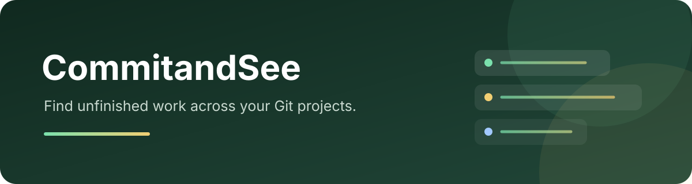

# CommitandSee



**A local-first Git dashboard for unfinished work across repositories, branches, worktrees, and stashes.** Bring current working-tree state together with selected commit history so you can see what needs attention and where to pick up next.

CommitandSee observes local checkouts read-only. It does not stage, commit, push, merge, reset, or delete work. It can also show published GitHub history for public repositories and, when configured, repositories you authorize through the GitHub App.

## Features

- Inspect staged, unstaged, untracked, and conflicted paths, linked worktrees, local branches, and stashes.
- Group repositories by product and view commit activity and line-change trends over time.
- See ahead/behind comparisons against locally cached upstream refs and ancestry-based integration hints.
- Export a snapshot for offline review; examine exported data before sharing because it can contain project metadata.
- Use GitHub sign-in to select authorized repositories; private repository history is cached locally and remains on disk after disconnect/removal.

The dashboard is an observation aid, not authoritative GitHub pull-request, CI, deployment, or merge status. See [`VERIFICATION.md`](VERIFICATION.md) for checked behavior and limits.

## Quick start: Windows portable app

Check the [Releases page](https://github.com/TOTALLYMAJOR/CommitandSee/releases) for the current package and its release notes/checksum. The portable Windows package includes Python; **Git for Windows 2.37 or newer is required**.

1. Download and extract the complete ZIP (keep `_internal` beside the executable).
2. Open `CommitandSee.exe` and keep its console window open.
3. In the dashboard choose **Add repository → Local checkout** and enter an existing checkout's absolute path.

The app starts with an empty list and does not search your computer automatically. The launcher prints the dashboard URL if a browser tab does not open. Closing the tab does not stop the app; press Ctrl+C in the console to stop it.

## Run from source

Requirements: Python 3.11+ and Git 2.37+. The source app does not require Node.js or third-party Python packages.

```bash
git clone https://github.com/TOTALLYMAJOR/CommitandSee.git
cd CommitandSee
python3 git_dashboard.py serve --repo /absolute/path/to/your/project
```

Open `http://127.0.0.1:8765`. On Windows, `py -3` can be used instead of `python3`. The server binds to loopback by default.

For saved repository additions/removals, launch with a configuration file:

```bash
python3 git_dashboard.py serve --config /path/outside/your/checkouts/config.json
```

A minimal config is:

```json
{
  "title": "My workspace",
  "timezone": "UTC",
  "repositories": []
}
```

For an offline HTML report, run `python3 git_dashboard.py scan --repo /path/to/repo --output /path/to/activity.html`. See the [source setup and options](README.md#run-from-source) and [`config.example.json`](config.example.json) for additional configuration. Keep config and report files outside monitored repositories.

## Privacy and data

Local checkouts are inspected without changing their Git history or working files. The app stores observation state and downloaded remote Git objects in its application data/cache directories. Authenticated private history can contain private repository content even when no checkout is created. Disconnecting GitHub or removing a source does **not** erase downloaded caches; review the data-handling details in the README's [data section](https://github.com/TOTALLYMAJOR/CommitandSee#where-your-data-lives) before using it with sensitive projects.

The dashboard's JSON/HTML exports and repository paths may contain private information. Review exports before sharing, and never attach tokens, private config, or private repository data to an issue.

## Development

```bash
python3 -B -m unittest -v
```

Optional browser regression tests require Node.js, Playwright, and browser installations; see the test instructions in the [full project documentation](https://github.com/TOTALLYMAJOR/CommitandSee#contribute-and-verify). Read [`CONTRIBUTING.md`](CONTRIBUTING.md) before opening a change.

## License

CommitandSee is licensed under the [MIT License](LICENSE).
